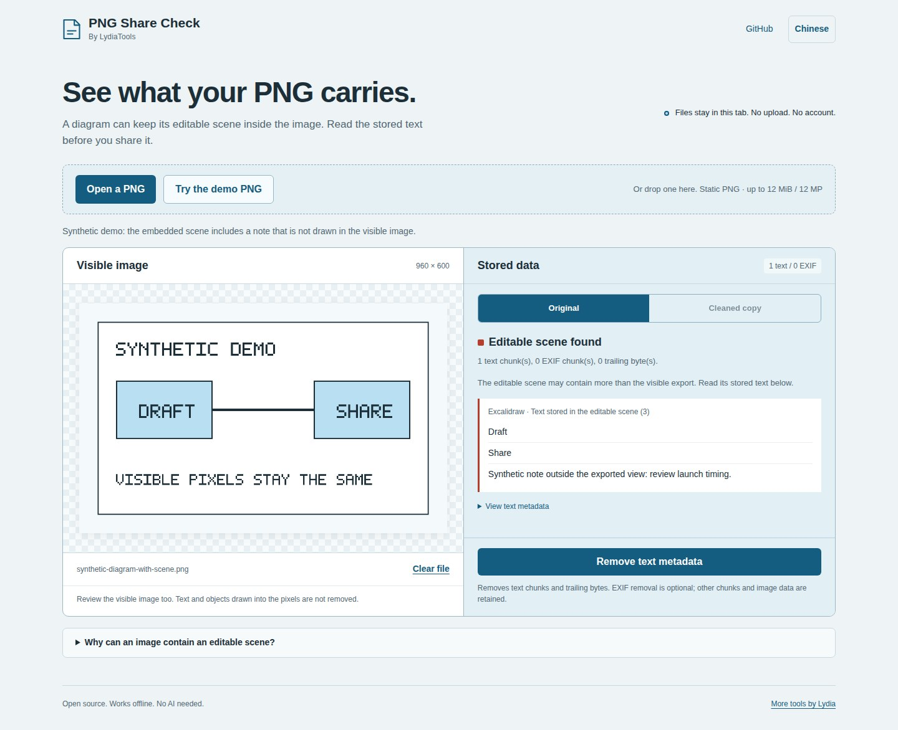

# PNG Share Check

### Your diagram is more than its pixels. See what else it carries.

PNG Share Check reads embedded editing data in PNG exports, shows supported Excalidraw scene text, and makes a copy without PNG text metadata. **The compressed image data stays byte-for-byte identical.**

[Open the app](https://lydiatools.github.io/png-share-check/) · [中文](README.zh-CN.md) · [Download an offline copy](https://github.com/LydiaTools/png-share-check/releases) · [Report a problem](https://github.com/LydiaTools/png-share-check/issues)



The demo image says “Draft” and “Share.” Its embedded scene also contains a synthetic note that isn't drawn in the image. You can see both before choosing what to download.

## Try it in a minute

1. Open the app and select **Try the demo PNG**, or open your own static PNG.
2. Compare **Visible image** with **Stored data**. Review the actual picture as well.
3. Select **Remove text metadata**, then **Download cleaned PNG**.
4. Open the verification details or download a report. Reopen the cleaned image to inspect it again.

EXIF is retained by default, including its orientation and any other information. If your file has EXIF, **Also remove EXIF** is an explicit choice. Removing it can rotate or mirror the displayed picture; compare the original and cleaned previews before sharing.

To reproduce that difference, open [`samples/diagram-with-exif.png`](samples/diagram-with-exif.png) in the app. It is also included in the offline ZIP.

No sign-up, API key, AI model or build step. Image processing runs in your tab. The app contains no analytics or upload endpoint. The hosted page still loads its static files from GitHub Pages; use the offline ZIP if you want to disconnect completely.

## What it does

| Task | Behavior |
| --- | --- |
| Inspect text metadata | Reads bounded `tEXt`, `zTXt` and `iTXt` entries. |
| Inspect editable drawings | Decodes legacy and supported byte-string Excalidraw scene envelopes; shows stored text elements. |
| Remove text metadata | Removes **all** `tEXt`, `zTXt`, `iTXt` chunks and bytes after `IEND`. EXIF removal is optional. |
| Keep compressed image data | Retains `IDAT` and other unselected chunks exactly, including color profiles and EXIF by default. No canvas re-encoding. |
| Verify the copy | Re-inspects it, compares SHA-256 of concatenated `IDAT` payloads, and offers a report without filenames or metadata values. |
| Work offline | Download the release ZIP, unzip it, and open `index.html`. English and Chinese are included. |

Excalidraw's “embed scene” option is a documented editing feature and is off by default in its export API. It is useful when you want to reopen a drawing. This tool helps when you intend to share just the image. It is independent of, and not endorsed by, Excalidraw. [Official export documentation](https://docs.excalidraw.com/docs/@excalidraw/excalidraw/api/utils/export).

## Scope you can check

**v0.1.1 is an early preview.** It accepts one static PNG up to 12 MiB and 12 megapixels. It checks chunk framing, CRCs and selected structural fields; it is not a complete PNG conformance validator. Animated PNG is rejected.

Cleaning removes the selected chunk types regardless of their meaning. This includes useful editing data, authorship and other provenance. Keep your editable original. EXIF stays unless you select its removal; it may contain information besides orientation. The report states how many EXIF chunks remain. Identical `IDAT` data does not guarantee identical display if orientation metadata is removed. The tool does not redact visible text, inspect every ancillary chunk, detect sensitive information, understand every editor's format or certify a file as private. Unknown ancillary chunks are retained and disclosed. Some color/profile chunks can themselves contain descriptive data and are also retained.

Limits bound decompression and displayed text. An undecodable text entry is reported and can still be removed. All file/scene text is displayed as text, never HTML. [Detailed behavior and limits](docs/scope.md).

## Verification, rather than a safety badge

- Core tests cover CRC/framing failures, supported scene envelopes, Unicode text, compression limits, unknown chunks, repeated cleaning and reports that exclude metadata values.
- Real-browser tests exercise both HTTP and `file://`, downloads and reinspection, pixel comparison, rendered script payloads, English/Chinese and mobile overflow.
- Orientation regression checks cover all eight EXIF orientations in both TIFF byte orders, default retention and explicit removal. v0.1.0 removed EXIF automatically; a real Chromium reproduction showed a rotated PNG changing display orientation despite identical `IDAT` bytes. v0.1.1 makes that removal optional and reports the retained data.
- Compatibility was checked against Excalidraw's public `test_embedded_v1.png`, `smiley_embedded_v2.png` and plain `smiley.png`, pinned to commit `bee01e3a12812c930109aa91242658709480bbf3`. Both embedded scenes decoded; cleaning preserved their `IDAT` data. Those files are not redistributed here.

These are implementation checks, not evidence of broad user adoption or exhaustive format compatibility. Generic metadata cleaners already exist; this preview focuses on readable scene text and verifiable PNG chunk removal.

## Run and develop

Open `index.html` directly, or serve this folder using any static server:

```sh
python3 -m http.server 8000
```

For tests (Node.js 22+):

```sh
npm ci
npm test
npx playwright install chromium
npm run test:browser
```

Local browser tests use an installed Chrome by default. Set `CI=1` to use Playwright Chromium, or `PNG_CHECK_BROWSER` to select an installed channel. Set `PNG_CHECK_RUN_DIR` to put screenshots and reports outside the repository. No runtime dependencies are shipped.

```sh
npm run samples            # Regenerate original synthetic fixtures
node scripts/package.cjs   # Assemble dist/ from an explicit allowlist
```

## Help shape the next version

Did you expect an editor's text to appear, or did a PNG fail? Open an issue with the editor/version and what you expected. Prefer a small synthetic reproduction. **Do not attach private drawings**; the issue tracker is public.

If this solves a problem for you, a Star helps other people find it. More practical tools: [LydiaTools](https://github.com/LydiaTools).

MIT. Original app, fixtures and screenshots. No third-party implementation is bundled. Format references: [PNG specification](https://www.w3.org/TR/png-3/), [Excalidraw JSON schema](https://docs.excalidraw.com/docs/codebase/json-schema/), [PNG metadata source](https://github.com/excalidraw/excalidraw/blob/bee01e3a12812c930109aa91242658709480bbf3/packages/excalidraw/data/image.ts).
