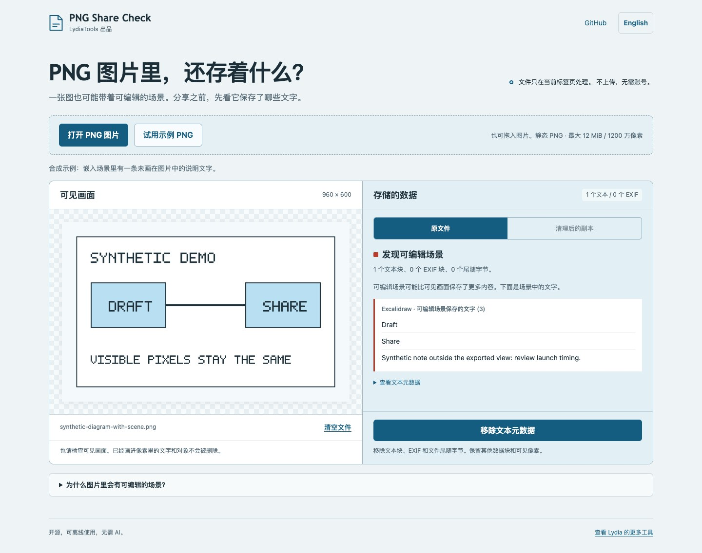

# PNG Share Check · PNG 分享检查器

### 分享一张图，也可能把编辑场景一起分享了。

检查 PNG 里存储的文字，读取支持的 Excalidraw 可编辑场景，生成移除文本元数据的副本。**压缩图像数据逐字节保持一致，不重新编码图片。**

[在线使用中文版](https://lydiatools.github.io/png-share-check/?lang=zh) · [English](README.md) · [下载离线版](https://github.com/LydiaTools/png-share-check/releases) · [反馈问题](https://github.com/LydiaTools/png-share-check/issues)



示例图只画了 Draft 和 Share，但它的编辑场景里还保存了一条合成说明。左边看画面，右边看数据，再决定下载什么。

## 一分钟试用

1. 打开工具，点击「试用示例 PNG」，也可打开自己的静态 PNG。
2. 对比「可见画面」与「存储的数据」，同时检查画面本身。
3. 点击「移除文本元数据」，再下载清理后的 PNG。
4. 查看字节级校验或下载报告，也可重新打开清理文件再次检查。

默认保留 EXIF，包括其中的方向及其他信息。文件含有 EXIF 时，可主动勾选「同时移除 EXIF」；移除后图片显示方向可能旋转或镜像，分享前可切换原文件与副本对比。

想复现这个差异，可在工具中打开 [`samples/diagram-with-exif.png`](samples/diagram-with-exif.png)，离线 ZIP 也包含此原创合成样本。

无需账号、API Key、AI 模型或构建。图片处理在当前标签页内完成，应用没有统计代码或上传接口。在线版仍会从 GitHub Pages 加载静态文件；需要完全断网时，请下载 ZIP，解压后打开 `index.html`。中英文界面都在同一个包里。

## 能做什么

| 任务 | 实际行为 |
| --- | --- |
| 查看文本元数据 | 有限额地读取 `tEXt`、`zTXt`、`iTXt`。 |
| 查看编辑场景 | 解码旧版及支持的 Excalidraw 字节串封装，列出其中的文字元素。 |
| 移除指定数据 | 移除全部文本块及 `IEND` 之后的字节；EXIF 可选择移除。 |
| 保留图像数据 | 原样保留 `IDAT`、色彩相关块和未选中的数据块，默认保留 EXIF，不通过画布重新编码。 |
| 校验副本 | 再次检查，并比较拼接 `IDAT` 数据的 SHA-256；报告默认不含文件名和元数据值。 |

Excalidraw 的嵌入场景是正常的编辑功能，其导出 API 默认关闭此选项。需要重新编辑时很有用；只想分享画面时，可以先检查。此工具独立开发，与 Excalidraw 没有关联或背书关系。[官方导出说明](https://docs.excalidraw.com/docs/@excalidraw/excalidraw/api/utils/export)。

## 当前范围

**v0.1.1 是早期预览版。** 每次处理一张静态 PNG，最大 12 MiB、1200 万像素。检查数据块边界、CRC 和部分结构字段，不是完整 PNG 格式验证器。暂不支持动画 PNG。

清理会移除选中的数据块类型，不判断内容用途；有价值的编辑信息、作者信息及其他来源记录也可能被移除，请保留原文件。默认保留的 EXIF 也可能含有方向以外的信息，报告会列出保留数量。即使 `IDAT` 数据一致，移除方向信息后，显示效果也可能变化。工具不会抹除画面中的文字，不识别敏感信息，不理解所有编辑器格式，也不提供隐私认证。未知辅助数据块会保留并提示；色彩配置等保留块本身也可能含有描述性信息。

解压和预览文字有上限。不能解码的文本块会提示，但仍可移除。所有文件文字均作为纯文本显示。[详细范围](docs/scope.md)。

## 已做的检查

包含核心解析测试，以及真实浏览器的在线／离线打开、下载后重读、逐像素对比、脚本载荷不执行、中英文与手机布局测试。另用 Excalidraw 官方仓库固定提交 `bee01e3a12812c930109aa91242658709480bbf3` 的旧版、新版嵌入 PNG 与普通 PNG 做过兼容性检查；两种场景都能解码，清理后 `IDAT` 一致。官方样本不随本项目分发。

这些属于实现验证，不代表广泛适用或用户采用。已有通用元数据清理工具；本项目专注于读懂场景文字与可核对的 PNG 数据块清理。

方向回归检查覆盖 8 种 EXIF 方向、两种 TIFF 字节序及主动移除选项。v0.1.0 会自动移除 EXIF，已在真实 Chromium 中复现「压缩图像数据一致、显示方向却改变」；v0.1.1 改为明确选择，并显示保留的数据数量。

## 本地运行与开发

直接打开 `index.html`，或使用任意静态服务器。测试需要 Node.js 22+：

```sh
npm ci
npm test
npx playwright install chromium
CI=1 npm run test:browser
```

默认本地浏览器测试使用已安装的 Chrome。测试输出目录可用 `PNG_CHECK_RUN_DIR` 指定。离线版与测试方式详见 [English README](README.md)。

欢迎反馈使用的编辑器、版本、预期结果以及最小合成样本。Issue 公开可见，请不要提交私人图片。如果有帮助，欢迎 Star；[LydiaTools](https://github.com/LydiaTools) 还有其他实用小工具。

MIT 开源。界面、合成样本和截图原创，未打包第三方实现。格式参考：[PNG 规范](https://www.w3.org/TR/png-3/)、[Excalidraw 场景格式](https://docs.excalidraw.com/docs/codebase/json-schema/)。
