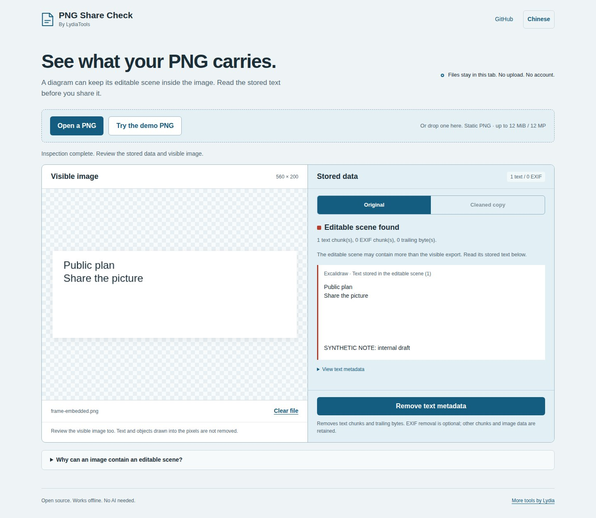

# A Frame's pixels and its editable scene

This example was generated by the **official Excalidraw npm SDK 0.18.1**, using an original synthetic scene. Its Frame shows “Public plan” and “Share the picture.” A later line in the same text element sits below the frame and remains in the embedded editing data.



## Try the actual files

1. Save the [SDK-exported PNG](https://raw.githubusercontent.com/LydiaTools/png-share-check/main/samples/editor-frame-embedded.png).
2. Open [PNG Share Check](https://lydiatools.github.io/png-share-check/) and choose that file. Compare the visible two-line image with the stored text ending in `SYNTHETIC NOTE: internal draft`.
3. Remove text metadata and download the copy. Reopen it: the editable scene is gone and the picture remains.

Also available: the [original scene](../samples/editor-frame.excalidraw), [actual cleaned download](../samples/editor-frame-without-text.png), and [machine-readable results and file hashes](evidence/editor-export.json). This extra example is downloaded separately; the fixed v0.1.1 offline ZIP is unchanged.

## What was measured

| Actual SDK export | Rendered size | Stored scene |
| --- | --- | --- |
| Frame with the synthetic last line, embedding on | 560 × 200 | Includes `internal draft` |
| Same Frame with only that last line changed, embedding on | 560 × 200 | Includes `alternate draft` |
| Same Frame, embedding off | 560 × 200 | None |

All three decoded RGBA hashes were `05502d800f51737b84ba3fe2f9f6f5557ba4222091209525248e610fe6e99d96`. The invisible-line control changes stored text without changing any rendered pixel. The third case verifies the explicit embedding choice.

The PNG Share Check UI then inspected the first actual export, downloaded a cleaned copy and re-inspected it. Its bytes matched the core cleaner's output; `IDAT` and decoded RGBA matched the input; no text chunks or scene remained. Chromium 151.0.7922.34, Linux, [completed run](https://github.com/LydiaTools/png-share-check/actions/runs/39479539874).

## Reproduce with the SDK

The optional [integration test](../tests/editor-export.cjs) creates the scene, calls the SDK, compares controls and exercises the actual inspector/download UI. The SDK and bundler are development-only dependencies installed outside the application. The SDK's package integrity is checked before the experiment.

In your fork, run **Official editor export experiment** from GitHub Actions. Or, with Node.js 22+:

```sh
npm ci
npx playwright install chromium
PNG_EDITOR_SDK_DIR="$(mktemp -d)"
export PNG_EDITOR_SDK_DIR
npm install --prefix "$PNG_EDITOR_SDK_DIR" --no-audit --no-fund --save-exact @excalidraw/excalidraw@0.18.1 react@19.0.0 react-dom@19.0.0 esbuild@0.25.5
node tests/editor-export.cjs
```

Output is in `runs/editor-export/`, including actual PNGs, source scenes, the SDK dependency lock, a UI screenshot and results. Rendering on another OS/browser can have different font rasterization; the comparison is among outputs from the same run.

The relevant SDK call supplies the two elements and the Frame:

```js
await exportToBlob({
  elements,
  files: {},
  appState: {
    exportEmbedScene: true,
    exportBackground: true,
    viewBackgroundColor: '#ffffff',
    exportWithDarkMode: false,
    exportScale: 1,
  },
  exportingFrame: frame,
  exportPadding: 0,
  mimeType: 'image/png',
});
```

Embedding is a documented editing feature, disabled by default in this API. This experiment tests this supplied scene/configuration in SDK 0.18.1. It does not test the hosted editor UI, its selection filtering, other versions or every export format. It is not a vulnerability claim. [Official export documentation](https://docs.excalidraw.com/docs/@excalidraw/excalidraw/api/utils/export).

## 中文

这个例子是用官方 Excalidraw npm SDK **0.18.1** 实际导出的原创合成场景。Frame 画面只显示 Public plan 和 Share the picture；同一文字元素中，框外的最后一行说明仍保存在主动开启的嵌入场景里。

下载上面的实际 PNG，放进[中文版工具](https://lydiatools.github.io/png-share-check/?lang=zh)，即可对照画面与存储文字。清理并下载后重新检查，场景数据消失，画面不变。源场景、实际副本与哈希也都可下载；这组补充案例不在固定的 v0.1.1 离线 ZIP 内。

验证包含三组实际 SDK 导出：原说明、改变框外末行、关闭场景嵌入。三者都是 560×200，可见 RGBA 完全相同；前两组读取到的末行不同，第三组没有场景。工具界面的真实清理下载也逐字节核对过，图像数据与显示像素保持一致。

这是限定输入和配置的 SDK 实验，没有测试网页版编辑器的选择／导出行为，也不将正常嵌入功能说成漏洞。测试素材全部由我们构造，不含他人私人文档。上面的 GitHub Actions 和本地命令均可重新生成并检查。
